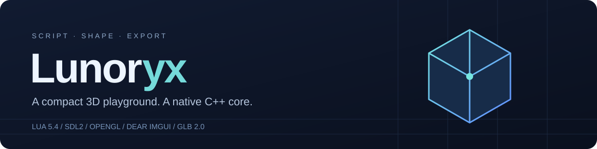

<p align="center">
  
</p>

<p align="center">
  <a href="https://github.com/kittkanev/Lua3D/actions/workflows/tests.yml"></a>
  
  
  
</p>

<p align="center"><b>Создавай сцену кодом. Меняй её в редакторе. Экспортируй в GLB.</b></p>
<p align="center">
  <a href="#быстрый-старт">Быстрый старт</a> ·
  <a href="#lua-api">Lua API</a> ·
  <a href="#проверки-качества">Тесты</a> ·
  <a href="#архитектура">Архитектура</a>
</p>

> **Ранняя тестовая версия · v0.1.0-alpha.1**
> Возможны баги, нестабильная работа и потеря несохранённых изменений.
> Выпуск предназначен для знакомства и тестирования. Сохраняйте резервные копии важных файлов.
>
> **[Скачать первый Windows-релиз](https://github.com/kittkanev/Lua3D/releases/tag/v0.1.0-alpha.1)** — архив содержит `Lunoryx.exe` и необходимую `SDL2.dll`.

**Lunoryx** (ранее Lua3D) — небольшой настольный 3D-редактор на C++ с Lua 5.4, OpenGL и Dear ImGui.
Сцена редактируется через инспектор или скрипт; `on_update(dt)` позволяет анимировать объекты без пересборки приложения.

| Создание сцены | Редактирование | Экспорт |
| :--- | :--- | :--- |
| Куб, пирамида, сфера, цилиндр, плоскость | Outliner, фильтр, трансформации, дублирование | Бинарный GLB 2.0 |
| Lua API и процедурная генерация | Докинг, консоль, пресеты материалов | Позиции, вращения, масштаб, PBR-факторы |
| Анимация через `on_update(dt)` | Орбитальная камера и wireframe | Один выровненный BIN-буфер |

## Быстрый старт

### Linux · Ubuntu / Debian

```bash
sudo apt-get update
sudo apt-get install -y build-essential liblua5.4-dev libsdl2-dev libgl1-mesa-dev

git clone https://github.com/kittkanev/Lua3D.git
cd Lua3D
make -j2
./engine
```

Заголовки tinygltf, nlohmann/json и stb уже находятся в `win_deps/`.
Требуется графическая среда с **OpenGL 2.1 compatibility** и GLSL 1.20.

### Windows · готовая сборка

Скачай **`Lunoryx-v0.1.0-alpha.1-windows-x64.zip`** со страницы
[Releases](https://github.com/kittkanev/Lua3D/releases/tag/v0.1.0-alpha.1).
Распакуй архив целиком и запусти **`Lunoryx.exe`**. `SDL2.dll` должна находиться рядом с приложением.
В архив включены пример Lua, инструкция и лицензии сторонних компонентов.

Актуальные сборки из `main` также доступны как артефакт `lua3d-windows-x64`
в [Build and tests](https://github.com/kittkanev/Lua3D/actions/workflows/tests.yml?query=branch%3Amain).

### Windows · кросс-компиляция на Linux

```bash
sudo apt-get install -y g++-mingw-w64-x86-64 curl make
bash tools/prepare_mingw.sh
make -j2 -f Makefile.win package
```

Результат: `build/win/engine.exe`, тесты и `SDL2.dll`.
Скрипт загружает Lua 5.4.6 и SDL2 2.30.0, проверяет SHA-256 и собирает Lua для MinGW.
Для собственных зависимостей можно передать `LUA_DIR=... SDL_DIR=...` в `make`.

## Первая анимация

Вставь код в **Script Editor** и нажми **Run Script**:

```lua
clear_scene()
local planet = add_object('Planet', 'sphere')
set_color(planet, 0.22, 0.65, 1.0)
set_material(planet, 0.25, 0.4)

local t = 0
function on_update(dt)
    t = t + dt
    set_position(planet, math.cos(t) * 3, 1, math.sin(t) * 3)
    set_rotation(planet, 0, t * 45, 0)
end
```

Готовый пример: [`examples/orbit.lua`](examples/orbit.lua).
Пауза и продолжение анимации доступны в верхней панели. **File → Export GLB** сохраняет `export.glb` в рабочий каталог.

## Управление

| Действие | Управление |
| :--- | :--- |
| Вращение камеры | Правая кнопка мыши + перетаскивание |
| Перемещение камеры | Средняя кнопка мыши + перетаскивание |
| Приближение | Колесо мыши |
| Выбор объекта | World Outliner |
| Трансформации и материал | Details |
| Дублирование / фокус / удаление | Кнопки в Details |
| Сетка, оси, wireframe | Меню View |

Мышь управляет камерой, когда её не перехватывают панели ImGui.

## Lua API

**Индексы начинаются с нуля.** После удаления последующие индексы сдвигаются.
Повторно вызывай `find_object(name)`, если структура сцены изменилась. Имена не обязаны быть уникальными;
поиск возвращает первое совпадение. Пустые имена допустимы.

| Функция | Результат / семантика |
| :--- | :--- |
| `add_object(name, type?)` | Новый индекс; тип по умолчанию `cube` |
| `find_object(name)` | Первый индекс или `-1` |
| `remove_object(index)` | `true` / `false` |
| `clear_scene()` | Удалить все объекты |
| `get_object_count()` | Число объектов |
| `duplicate_object(index, name?)` | Новый индекс или `-1`; копирует свойства без смещения |
| `set_name(index, name)` | `true` / `false` |
| `set_position(index, x, y, z)` | `true` / `false` |
| `get_position(index)` | `x, y, z` |
| `set_rotation(index, x, y, z)` | Углы в **градусах**; `true` / `false` |
| `get_rotation(index)` | Три угла в градусах |
| `set_scale(index, x, y, z)` | `true` / `false` |
| `get_scale(index)` | Три компонента масштаба |
| `set_color(index, r, g, b)` | Компоненты ограничиваются `[0, 1]`; `true` / `false` |
| `get_color(index)` | `r, g, b` |
| `set_material(index, metallic, roughness)` | Факторы ограничиваются `[0, 1]`; `true` / `false` |
| `get_material(index)` | `metallic, roughness` |
| `set_visible(index, value)` | Lua truthiness; `true` / `false` |
| `set_wireframe(index, value)` | Lua truthiness; `true` / `false` |
| `get_time()` | Секунды от инициализации SDL |
| `export_glb(filename)` | `true` при успешной записи |

Геттеры свойств при неверном индексе не возвращают значений. Сеттеры трансформаций, цвета и материала
проверяют все компоненты **до изменения объекта**: `NaN`, `Inf` и числа за пределами `float` вызывают Lua-ошибку.
Неподдерживаемое строковое имя меша совместимо с прежним API и выбирает куб.

### Жизненный цикл скрипта

- Новый запуск очищает предыдущий `on_update`; глобальные Lua-переменные остаются в том же состоянии.
- Ошибка `on_update` приостанавливает симуляцию и записывается в консоль.
- Вызовы движка восстанавливают высоту Lua-стека; ошибки метаметодов обрабатываются защищённо.
- На запуск и обновление действует лимит в **1 000 000 Lua-инструкций**, чтобы прерывать случайные бесконечные циклы.

Скрипты считаются доверенными: стандартные библиотеки Lua открыты. Это не песочница;
скрипт может работать с файлами и процессами, а `debug.sethook` способен изменить ограничитель инструкций.

## Проверки качества

```bash
make test                 # C++-ядро, геометрия, кватернионы, timeout
make test-integration     # Lua API, ошибки, стек и GLB round-trip
```

CI проверяет:

| Проверка | Что покрывает |
| :--- | :--- |
| Linux `g++`, `-Wall -Wextra -Werror` | Сборка редактора и тестов |
| ASan + UBSan + LeakSanitizer | Ошибки памяти, неопределённое поведение, повторное создание Lua-state |
| Khronos glTF Validator | Независимая проверка экспортированного GLB; ошибки блокируют CI |
| Xvfb + Mesa | Запуск редактора и штатное завершение по `TEST_TIMEOUT` |
| MinGW-w64 | Кросс-компиляция редактора и тестов с `-Werror` |
| Windows | Запуск собранных MinGW-тестов на Windows |

Vendored-заголовки подключаются как системные: предупреждения в собственном коде остаются ошибками сборки.
В отчёте glTF отдельно сохраняются предупреждения и информационные замечания.

Для локальной диагностики памяти:

```bash
make clean
make -j2 test-integration \
  EXTRA_CXXFLAGS='-O1 -g -fsanitize=address,undefined -fno-omit-frame-pointer' \
  EXTRA_LDFLAGS='-fsanitize=address,undefined'
```

### Автоматическое завершение

```bash
TEST_TIMEOUT=5 ./engine
# Без монитора, при наличии Xvfb и Mesa:
xvfb-run -a env LIBGL_ALWAYS_SOFTWARE=1 TEST_TIMEOUT=2 ./engine
```

`TEST_TIMEOUT` принимает целые десятичные секунды. Пустое, нулевое или некорректное значение отключает таймер;
слишком большое ограничивается 3 600 000 секундами. `make clean` сохраняет экспортированные GLB.

## Архитектура

| Путь | Назначение |
| :--- | :--- |
| `main.cpp` | SDL/OpenGL, ImGui, Lua API, GLB |
| `scene_core.h` | Объекты, примитивы, кватернионы, timeout |
| `imgui/` | Dear ImGui и платформенные бэкенды |
| `win_deps/` | tinygltf, json и stb |
| `examples/` | Скрипты для редактора |
| `tests/` | Регрессионные и интеграционные тесты |
| `tools/` | Подготовка MinGW и валидация GLB |

## Границы текущей версии

Lunoryx использует фиксированный OpenGL-пайплайн с простым затенением граней. PBR-факторы сохраняются в GLB;
viewport не является физически корректным PBR-рендерером. Импорт внешних мешей, текстуры, физика,
undo/redo и полноценное сохранение проекта пока не реализованы. GLB сохраняет видимую геометрию и материалы,
но не Lua-код, анимационные callbacks, wireframe и раскладку редактора.

Автоматические проверки не заменяют испытания на целевых GPU; Windows CI выполняет тесты ядра и API,
а графический smoke-тест работает на Linux с Mesa. Критерии проверенной сборки описаны выше;
статус всего движка как универсального production-ready SDK не заявляется.

<details>
<summary><b>Зависимости и лицензии</b></summary>

- [SDL2](https://github.com/libsdl-org/SDL) — zlib.
- [Lua](https://www.lua.org/license.html) — MIT.
- [Dear ImGui](https://github.com/ocornut/imgui) — MIT.
- [tinygltf](https://github.com/syoyo/tinygltf) — MIT.
- [nlohmann/json](https://github.com/nlohmann/json) — MIT.
- [stb](https://github.com/nothings/stb) — MIT или public domain.

Лицензии сторонних компонентов действуют отдельно. Лицензия на собственный код Lunoryx
пока не указана владельцем репозитория.

</details>
